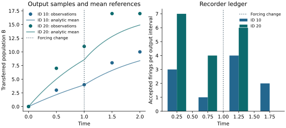

# Independent exact-SSA banks

`BatchedDirectSSASolver` gives every independent replicate its own event clock.
State is `(local_species, replicate)` and hazards are `(local_channel, replicate)`.
One local stoichiometric matrix is shared; no global block matrix expands with
bank size. A sweep evaluates hazards once and advances each active replicate by
one event or boundary. This avoids reevaluating the entire bank for every event
in the superposed `DirectSSASolver` process.

The first implementation is eager NumPy CPU execution. It supplies no stochastic
gradient estimator, accelerator driver, tau-leaping or jump/ODE hybrid mode.
Those require separate implementations and qualification.

## Read a two-replicate simulation

The executable [two-replicate example](https://github.com/ACCIDDA/op_engine/blob/main/examples/replicate_ssa.py)
has a numerical illustration:



--8<-- "docs/assets/replicate-ssa/summary.txt"

Each initial A individual transfers once to B. The base rate is multiplied by
one before `t = 1` and two thereafter. Thus the analytic mean remaining in A is
`A(0) * exp(-rate * (min(t, 1) + 2 * max(t - 1, 0)))`. The smooth curves show
the corresponding mean B; markers are observations on the output grid. They
do not reconstruct every event time. The two IDs have different initial
populations and rates and are not an IID bank for estimating one distribution.
The firing ledger agrees with the transferred population in each replicate.

[Download the vector PDF](../assets/replicate-ssa/figure.pdf). From a checkout,
regenerate with:

```bash
uv run --with matplotlib==3.11.2 python -m examples.illustrate_replicate_ssa
just figures-check
```

The source example checks population conservation, firing counts, bank-order
invariance and shard replay. `figures-check` reruns it and checks the generated
table, complete plotted data, source identity and export hashes without a
plotting dependency. The [plotted data](../assets/replicate-ssa/data.json) retains
the numerical inputs.

## Compile an independent model

With `op-system==0.8.0` or later:

```python
import numpy as np
from op_system import compile_spec
from op_engine import (
    BatchedDirectSSASolver, BatchedSSAConfig, FiringRecorder, ModelCore,
    from_compiled_replicates,
)

compiled = compile_spec({
    "kind": "transitions",
    "axes": [{"name": "rep", "coords": ["a", "b"]}],
    "factorize_axes": ["rep"],
    "state": ["S[rep]", "I[rep]"],
    "transitions": [
        {"name": "infect", "from": "S[rep]", "to": "I[rep]", "rate": "beta[rep]"},
        {"name": "recover", "from": "I[rep]", "to": "S[rep]", "rate": "gamma"},
    ],
})
network = from_compiled_replicates(
    compiled, {"beta": np.array([0.2, 0.4]), "gamma": 0.1}, batch_axis="rep"
)
core = ModelCore(2, 2, np.arange(11, dtype=float))
core.set_initial_state(np.array([[90., 70.], [10., 30.]]))
counts = FiringRecorder((0,))
BatchedDirectSSASolver(core, network.stoichiometry).run(
    network.propensity, rng=np.random.SeedSequence(2026), replicate_ids=[8, 19],
    config=BatchedSSAConfig(forcing_breakpoints=network.forcing_breakpoints),
    recorder=counts,
)
trajectory = core.state_array
infection_counts = counts.counts
```

All evolving templates must carry the certified batch axis. Each reaction must
preserve that coordinate and read only its own replicate's state. Shared fixed
parameters are allowed. Cross-replicate reductions, routed transfers, omitted
reactions, unrepresented operators and missing independence certificates are
errors. Shapes alone cannot certify independence. The compiler checks reactions
before deterministic cancellation, so cancelling drift is insufficient evidence.

Other local axes, pinned local cells and routed local channels retain the
existing compiler conventions. `pack_state` converts a full compiler flat state
to a local bank; `flatten_history` restores full compiler cell order. The batch
axis can occupy any declared template position. Channel names/indices describe
local channels, with the replicate dimension separate.

## Forcing and observations

Hazards must be constant in external time between events and declared forcing
changes. The compiled adapter rejects explicit continuous-time dependence and
nonconstant `linear` tables. `previous` time parameters must explicitly carry the
replicate axis, even when the table values are shared across replicates; broadcast
those values when constructing the table. This gives the compiler a declared
dimension for the different current values at asynchronous clocks.

The adapter selects a table row per replicate and resolves each consumed table
once per hazard evaluation. Pass its `forcing_breakpoints` to the solver config.
Generic NumPy callbacks receive the full vector of clocks and can implement
shared or per-replicate forcing with `forcing_breakpoints` and
`replicate_breakpoints`, respectively. Declaring an arbitrary time grid does not
make a continuously changing hazard piecewise constant.

Pending events survive pure output boundaries, so refining the output grid does
not change a seeded path. A forcing boundary wins a tie and discards the candidate
event. A pure output boundary includes an event exactly at that time. Zero rates
wait for the next forcing change or remain absorbing. Event limits apply to each
replicate in each output interval. Initial counts must be finite, non-negative
integers; impossible consumption and non-advancing event times fail explicitly.

The optional `FiringRecorder` uses the same accepted-event contract as ordinary
SSA. Counts are host int64 diagnostics shaped `(interval, selected_channel, rep)`.
They consume no random numbers; enabling recording preserves the trajectory.

## Random streams and replay

A root `SeedSequence` plus distinct unsigned 64-bit `replicate_ids` defines native
PCG64DXSM streams under versioned scheme OPB1. IDs are framed in the spawn path,
not derived by batch-dependent `spawn()`. Paths replay under reordering, smaller
banks and disjoint shards for unchanged inputs and schedules. No cross-version,
cross-backend bitwise identity is promised.

Alternatively pass one NumPy Generator/SeedSequence per replicate. Generators
advance in place; SeedSequences initialize fresh runs. Duplicate stream states
are rejected. The caller owns independence of explicitly supplied streams. An
`op_infer.rng.RandomKey` can supply each simulation SeedSequence without adding
an inference dependency to the engine. Common random numbers across designs use
the same addresses in separate runs, while each bank retains independent IDs.

Runs replay from their initial state. Mid-trajectory checkpoint/resume with
pending-event state is not implemented; a workflow can resume completed replicate
artifacts or replay unfinished replicates from their original inputs.

## Measurements

Run the standalone correctness-gated benchmark:

```shell
python -m benchmarks.replicate_ssa --sizes 16 64 256 1024 --days 30 \
  --flat-max 64 --output /tmp/replicate-ssa.json
```

JSON separates compiler/setup/execution costs and records events, sweeps, matrix
storage, source identity and environment. The flat comparison is bounded by
`--flat-max`; large superposed banks can be expensive. Timings are not portable
thresholds. Required small analytic/replay/compiler/provider tests establish
correctness; large measurements remain opt-in. Heterogeneous event workloads can
increase sweep counts with bank size, so benchmark the intended parameter bank.
